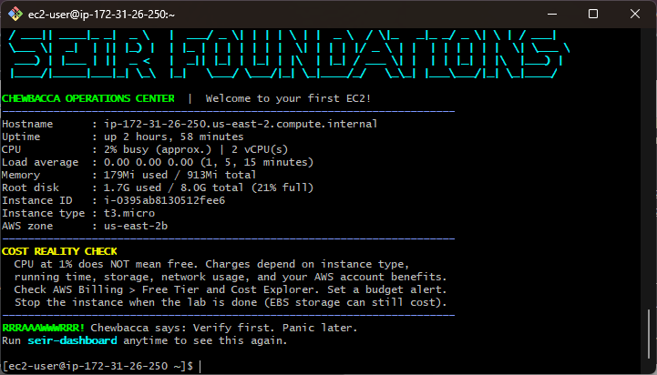
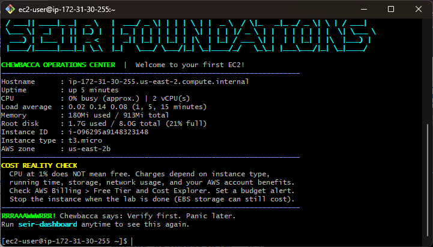
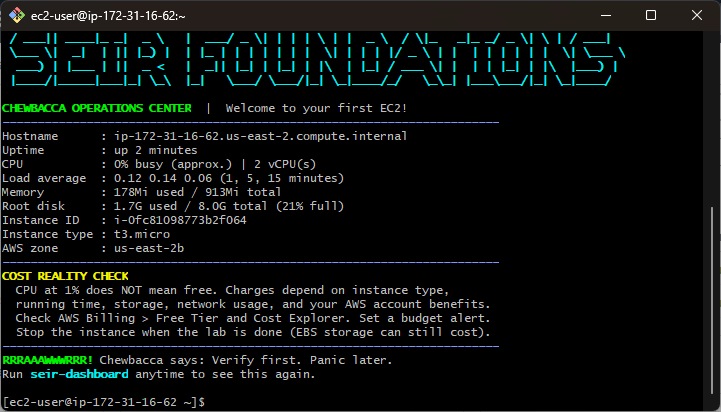
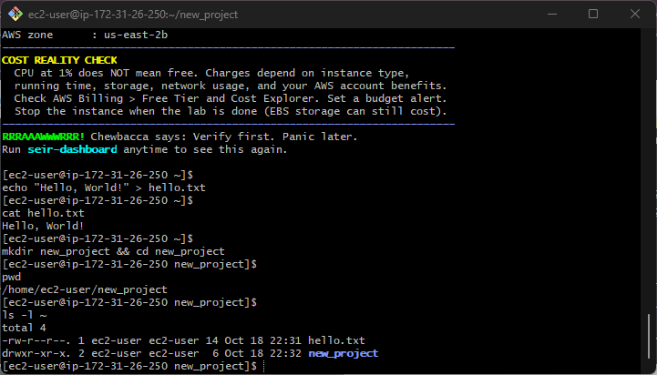

# Module 1, Lab 0 — SEIR Foundations

## Deployment Evidence

| Deployment | Public IPv4 Address | Connection Method | Screenshot | Instance Terminated? |
|---|---|---|---|---|
| 1 — Initial manual launch | `18.223.99.67` | Git Bash SSH | [Deployment 1](screenshots/deployment-1.png) | Yes |
| 2 — Launch template | `3.138.195.206` | Git Bash SSH | [Deployment 2](screenshots/deployment-2.png) | Yes |
| 3 — Launch template | `18.117.136.252` | Git Bash SSH | [Deployment 3](screenshots/deployment-3.png) | Yes |

**AWS Region:** `us-east-2` (Ohio)  
**Operating System:** Amazon Linux 2023  
**Instance Type:** `t3.micro`  
**Retained Launch Template:** `Class8-Week1-Lab0`

The three deployments received distinct public IPv4 addresses. Deployment 1 was launched manually before I created the reusable launch template; Deployments 2 and 3 used the saved template.

## Deployment Process

### Deployment 1 — Initial EC2 Launch

I manually launched an Amazon Linux 2023 EC2 instance using the `t3.micro` instance type in the `us-east-2` region. I connected from my Windows computer using Git Bash, SSH, and my assigned private key. After connecting successfully, I ran the SEIR Foundations dashboard. It reported approximately 2% CPU utilization, 179 MiB of memory used out of 913 MiB, 21% disk utilization, and an uptime of 2 hours and 58 minutes. I saved a screenshot of the dashboard and later created a reusable launch template for the following deployments.



### Deployment 2 — Launch Template Practice

For my second deployment, I used the saved `Class8-Week1-Lab0` launch template to create another Amazon Linux 2023 EC2 instance. I waited for the instance to start, connected using Git Bash SSH, and verified that the SEIR Foundations dashboard worked. It showed approximately 0% CPU utilization, 180 MiB of memory used out of 913 MiB, 21% disk utilization, and an uptime of approximately five minutes. Reusing the template made the deployment more consistent and meant that I did not need to enter every configuration setting again.



### Deployment 3 — Repeated Deployment

For my third deployment, I reused the same launch template, checked that the instance had its own public IPv4 address, and connected successfully through Git Bash SSH. The SEIR Foundations dashboard showed approximately 0% CPU utilization, 178 MiB of memory used out of 913 MiB, 21% disk utilization, and an uptime of approximately two minutes. By the third attempt, I was more comfortable finding instance details, connecting remotely, and verifying the dashboard.



## What CPU, Memory, Disk, and Uptime Tell Me About the Instance

CPU usage indicates how much processing capacity is being used at a particular moment. Memory shows how much RAM the operating system and applications are consuming. Disk usage shows how much of the allocated storage is occupied and how much remains available. Uptime measures how long the instance has been running since its most recent boot. Together, these measurements help me understand resource usage and identify whether the instance may need attention. I also learned that low CPU utilization does not mean the instance is free: running time and other AWS resources can still consume credits or incur charges.

## One Thing That Became Easier After Repeating the Process

Launching EC2 instances became easier after the first attempt, especially when I reused the launch template. I became more comfortable navigating the AWS Console, finding the public IPv4 address, connecting through Git Bash SSH, and running the SEIR dashboard. By the third deployment, I understood the sequence of steps and needed less assistance.

## Errors Encountered and How I Resolved Them

On my first SSH attempt, the server closed the connection after I verified its host-key fingerprint. I retried using SSH verbose mode and connected successfully. I also tried running `explorer.exe` while I was still inside the remote Linux session, which returned a command-not-found error. I resolved that by exiting SSH and running the Windows-specific command from my local Git Bash window. These issues helped me understand the difference between my local computer and the remote EC2 instance.

## Linux Command Practice

After connecting through SSH, I practiced creating and reading a text file, creating and entering a directory, printing the current working directory, and listing my home directory:

```bash
echo "Hello, World!" > hello.txt
cat hello.txt
mkdir new_project && cd new_project
pwd
ls -l ~
```



## Confirmation That I Retained the Launch Template and Cleaned Up Practice Instances

I retained the reusable EC2 launch template, `Class8-Week1-Lab0`, for future labs. After saving the required deployment and Linux practice evidence, I terminated all three practice EC2 instances. I verified in the AWS EC2 console that `zsmith_lab0`, `Class8-Lab0-Deployment-2`, and `Class8-Lab0-Deployment-3` each displayed **Terminated**. The evidence table above reflects that completed cleanup.