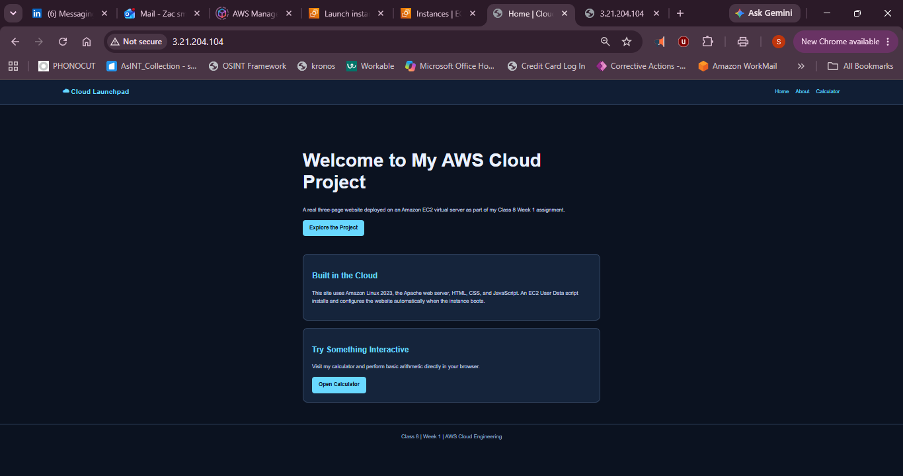
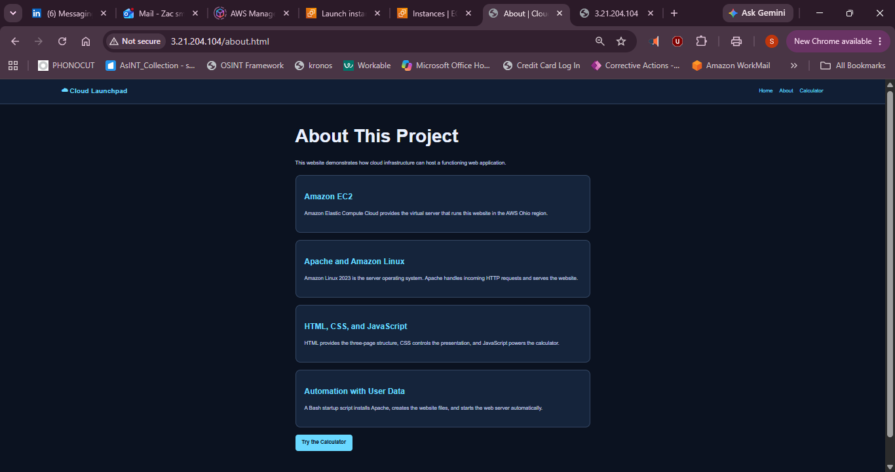
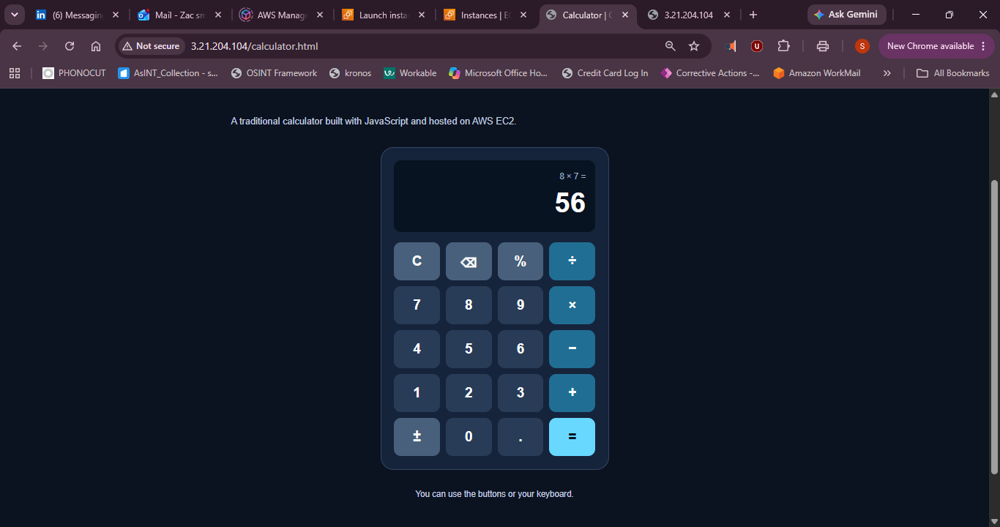

# Class 8 — Week 1 AWS Website Project

## Project Overview

For my Class 8 Week 1 assignment, I created and deployed a three-page website using an Amazon EC2 instance. The website uses HTML, CSS, JavaScript, and Apache running on Amazon Linux 2023.

The website includes an interactive calculator that allows users to perform arithmetic operations using clickable buttons or their keyboard.

## Live Website

**Public IPv4 address used during deployment:** `3.21.204.104`

**Website URL:** http://3.21.204.104/

*Note: This website is accessible while the EC2 instance is running with this public IP address.*

## AWS Configuration

| Resource | Configuration |
|---|---|
| AWS Region | us-east-2 (Ohio) |
| Operating System | Amazon Linux 2023 |
| Instance Type | t3.micro |
| Instance Name | Class8-Week1-Website |
| Launch Template | Class8-Week1-Lab0 (Version 1 reused) |
| Security Group | lab0sg |
| HTTP | Port 80 |
| SSH | Port 22 |
| Web Server | Apache (httpd) |

## Website Pages

### Page 1 — Home

Introduces my AWS cloud project and provides navigation to the other pages.

### Page 2 — About

Explains the project's AWS infrastructure and the technologies used to create the website.

### Page 3 — Interactive Calculator

A traditional-style calculator developed using JavaScript. It supports basic arithmetic operations, displays calculation history, and includes clickable buttons.

I tested the calculator successfully using:

**8 × 7 = 56**

## Troubleshooting and Lessons Learned

During the initial EC2 launch, the User Data startup script failed during cloud-init execution. Although AWS reported that the instance passed its health checks, Apache had not been installed and the website initially timed out.

I connected to the instance through Git Bash using SSH, examined the cloud-init logs, and validated the saved startup script using Bash syntax checking.

After confirming that the script passed the syntax check, I manually executed the saved script. Apache installed successfully, the website files were created, and the web server started.

I verified the server locally using `curl` and received `HTTP/1.1 200 OK`. I then confirmed that all three pages were accessible through the instance's public IPv4 address.

This exercise taught me that AWS instance health checks do not necessarily confirm that an application is functioning correctly. I also gained experience troubleshooting User Data, working with Linux services, and deploying updates to a running EC2 instance.

## Project Files

- `site/index.html` — Home page
- `site/about.html` — About page
- `site/calculator.html` — Final interactive calculator with JavaScript
- `site/style.css` — Shared website styling
- `screenshots/` — Evidence of the three working pages

## Final Reflection

This project helped me understand how an EC2 instance can host a public website, how User Data can automate server configuration, and how to troubleshoot application failures using SSH and Linux command-line tools.

I also learned how to improve an existing website and preserve its final source code for future deployments.